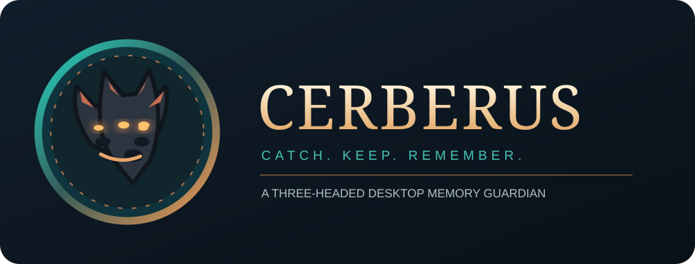
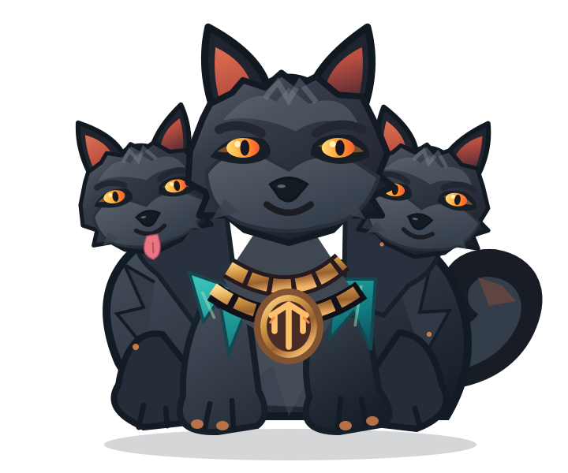

<div align="center">

# CERBERUS
### The three-headed guardian of your digital memory.

**Catch it. Keep it. Find it.**

An animated, local-first desktop companion that catches text, URLs and files you feed it, then guards them in a searchable vault.





[](https://github.com/iAlirezaaa/Cerberus/actions/workflows/ci.yml)

</div>

## What is Cerberus?

Cerberus is a playful desktop pet with a real job: capturing information. Drag text, a link, a local file or an image onto the three-headed hellhound. It catches the item, enters a short Hades-portal animation, and saves it into your **local**, searchable memory vault.

Inspired by desktop pets such as Shimeji, Cerberus adds an information capture and retrieval layer rather than just screen decoration.

**Current status: early MVP, not a production release.** Features below are implemented in source; platform-specific GUI behavior still needs device testing.

## Features in this version

- **Three-headed animated desktop pet:** translucent, frameless, always-on-top Qt overlay; original transparent vector character sprite with idle/breathing, portal, dash, catch, celebrate, play and sleeping reactions.
- **Feed it by dragging:** text, HTTP(S) links, local files and dropped image data are captured.
- **Portable memory vault:** local SQLite database with FTS5 full-text indexing when available and an indexed fallback; files are **copied**, never moved from their source.
- **Find what it swallowed:** desktop search window and command-line search/list/export/delete commands.
- **Clipboard capture (opt-in only):** disabled by default; when enabled, newly copied clipboard text/URLs/images can be captured with an animation. **Selecting/highlighting text alone does not trigger capture in this MVP.**
- **System tray controls:** show/hide, open vault, manually feed clipboard, toggle clipboard capture, summon, play, guard, standby/sleep, resize (three sizes), reduced-motion mode and quit.
- **Safe defaults:** no account, cloud service, analytics, microphone, network upload or hidden clipboard collection. Data stays under your user profile unless you override the data directory.
- **Duplicate detection, capture limits, atomic file writes and unit tests.**

## Quick start

Requires **Python 3.11+**. Desktop GUI requires PySide6. Tested logic is platform-independent; the GUI is primarily targeted at Windows 10/11, with macOS/Linux support to be validated.

```powershell
git clone https://github.com/iAlirezaaa/Cerberus.git
cd Cerberus
python -m venv .venv
.venv\Scripts\activate
python -m pip install -e ".[gui]"
cerberus-desktop
```

On macOS/Linux, activate with `source .venv/bin/activate`.


### On-screen desktop controls

| Action | What Cerberus does |
| --- | --- |
| Start `cerberus-desktop` | Appears as a transparent always-on-top character near the bottom-right of the primary monitor |
| Drag text, URL, image or file onto the character | Captures locally, runs portal > dash > catch > celebrate |
| Single-click | Bounces / reacts to being petted |
| Double-click | Opens the searchable vault |
| Left-drag | Repositions the companion on screen |
| Right-click or use tray menu | Summon, sleep, guard, play, show/hide, resize, reduced motion |
| 95 seconds of inactivity | Enters an energy-saving sleeping stance (no data collection) |

The SVG body currently animates as one rigless layer with expressive transforms and procedural FX. Independently articulated heads, paws and tail are planned for a future animation atlas. Transparent portions of the window are **not** native click-through yet.

### Optional standalone Windows .exe

From PowerShell in the repo root (requires Python on the build machine):

~~~powershell
.\scripts\build_windows.ps1
~~~

Output: dist/Cerberus.exe. This currently produces an **unsigned** build; it may trigger Windows SmartScreen. No executable is published as a verified release yet. Packaging needs on-device validation.

### Try the vault from a terminal

```bash
python -m cerberus add-text "A thought worth keeping" --title "My note"
python -m cerberus add-url "https://example.org"
python -m cerberus add-file "./notes.pdf"
python -m cerberus search "thought"
python -m cerberus list
python -m cerberus export ./cerberus-export.json
python -m unittest discover -s tests -v
```

**Character asset:** [guardian.svg](cerberus/assets/guardian.svg) is a standalone, alpha-transparent vector sprite, shipped inside the app. The Qt renderer caches it as a high-resolution image and applies deterministic time-based transforms plus portal, paper-capture and particle effects. The motion pipeline lives in [motion.py](cerberus/motion.py).

Run `python -m cerberus --help` for all commands. Override the data directory with `CERBERUS_HOME`.

## How it works

1. Drop text, URLs, a file or an image **onto Cerberus** (or use the CLI).
2. Cerberus plays a portal/catch reaction and writes the item to the local vault.
3. Double-click the pet or use the tray menu to search and retrieve it.
4. Single-click to pet Cerberus, drag the pet with the left mouse button to reposition it, or right-click for the tray actions. After roughly 95 seconds without interaction it settles into a sleeping standby pose; hover or interact to wake it.

The global-selection animation described in the original concept will require a separate, **explicitly enabled** OS accessibility integration. Ordinary selection in arbitrary applications is not observable through Qt alone. Clipboard capture works after an actual copy action, never merely because text is highlighted.

## Why this architecture?

The MVP uses a **Python core + PySide6 desktop shell** for fast iteration and a transparent window that accepts native drag-and-drop. Storage, metadata and deduplication live in pure Python with no Qt dependency, so they can be reused later by a native Rust/Tauri shell if performance benchmarks justify migrating.

- **Core:** `cerberus/vault.py` — capture, SQLite, FTS, safe file copies, export.
- **Preferences:** `cerberus/settings.py` — opt-in settings, local profile storage.
- **Pet:** `cerberus/pet.py` — native drag/drop, procedural mascot, animation phases.
- **Desktop:** `cerberus/app.py` — tray, vault search, clipboard integration.
- **CLI:** `cerberus/cli.py` — scriptable memory operations.

See [Architecture](docs/ARCHITECTURE.md), [Roadmap](docs/ROADMAP.md), and [Privacy](docs/PRIVACY.md).

## Safety & privacy

Nothing is uploaded to a server. The local vault is **not encrypted at rest yet**; it inherits the current user's filesystem permissions. Don't use it for secrets or passwords. An export contains text/URLs and file metadata, not copied file bytes. Imported file contents are limited to 50 MiB per item; text to 1 MiB. Data is kept until you delete it. Clipboard watching starts OFF.

## Planned

Native selected-text detection **with explicit user consent**, cursor-relative portal entrances, richer sprite animations, multi-monitor awareness, configurable animation behavior, encrypted vault, OCR, semantic search, browser companion, plugin SDK, optional integration with second-brain systems, packaging and signed releases. Nothing in this paragraph is claimed as shipped.

## Contributing

Issues and pull requests are welcome. Please include reproduction steps and OS details for platform-specific bugs. Run `python -m unittest discover -s tests` before opening a PR.

**License:** [MIT](LICENSE)
