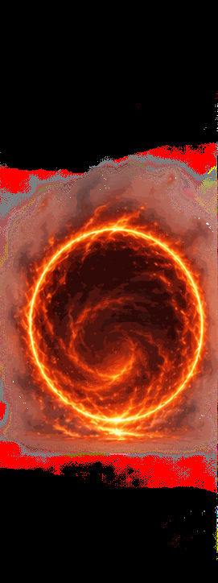
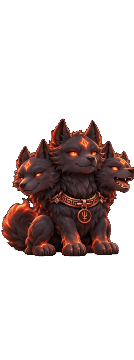

# Cerberus — Generated Motion Assets

Two original AI-generated animation sequences based on the user-provided three-headed Cerberus character reference. The complete binary source assets are tracked in GitHub.

## Previews

**Portal entrance — 8 frames**



**Bored / look-around — 8 frames**



## Directory layout

```text
assets/animations/
  cerberus_portal_enter.gif
  cerberus_bored_lookaround.gif
  animation-pack.json
  sheets/
    portal_sheet.png
    bored_sheet.png
  frames/
    portal_enter/portal_01.png ... portal_08.png
    bored_lookaround/bored_01.png ... bored_08.png
```

- Portal frames: **271×724 RGBA PNG**, 8 frames; timing [120, 120, 120, 120, 120, 120, 160, 400] milliseconds.
- Bored frames: **269×719 RGBA PNG**, 8 frames; timing [160, 140, 140, 140, 140, 160, 160, 300] milliseconds.
- Sprite sheets: **2172×724 RGBA PNG** each.
- GIFs: **8-frame GIF89a**, repaired to reserve the transparent palette index correctly; GIF transparency is binary (on/off), unlike PNG alpha.
- The original sources have **visible smoke/ember glow** and minor cutout edge artifacts from generation. They are not polished skeletal motion, and the bored sequence contains subtle rather than major poses.
- Portal GIFs loop indefinitely as stand-alone preview files. In the app, the JSON pack sets `portal.loop=false` for one-shot playback; idle loops.

## Use inside Cerberus

The current desktop app defaults to its existing `cerberus/assets/animation-pack.json` / bundled character. To try these new images without replacing that default:

Windows PowerShell:
```powershell
$env:CERBERUS_ASSET_PACK = (Resolve-Path "assets/animations/animation-pack.json").Path
cerberus-desktop
```

Linux/macOS:
```bash
CERBERUS_ASSET_PACK="$(pwd)/assets/animations/animation-pack.json" cerberus-desktop
```

The optional pack uses PNG frames and supports `idle` and `portal` states. Other states fall back to the default sprite. Since all frames are tall and the underlying runtime was initially sized for a shorter illustration, confirm scaling before enabling this pack for all users. See [Animation Pack docs](../../docs/ANIMATION_PACK.md).

## Packaging

Run `python scripts/package_animation_assets.py` at the repository root. This writes `dist/Cerberus-visual-assets.zip` with all animation and concept assets, the root LICENSE and NOTICE. GitHub Actions also creates an artifact when assets change.

**Source control note:** Do not commit the generated ZIP as a duplicate of these files; version the GIFs, source images and frames. Do not remove the alpha channel from the PNGs or replace frames with screenshots.
