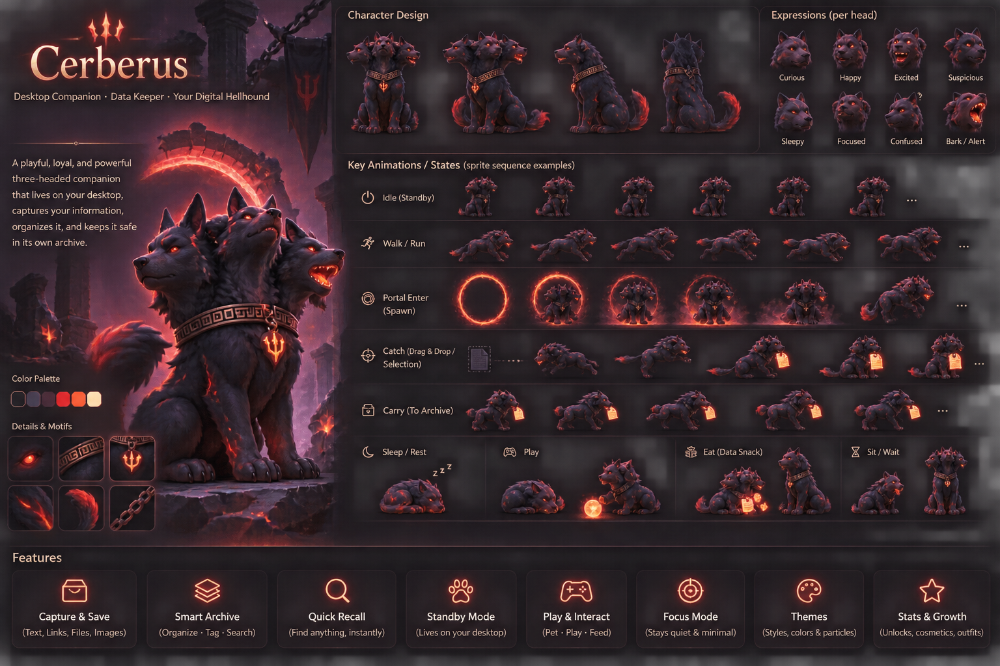
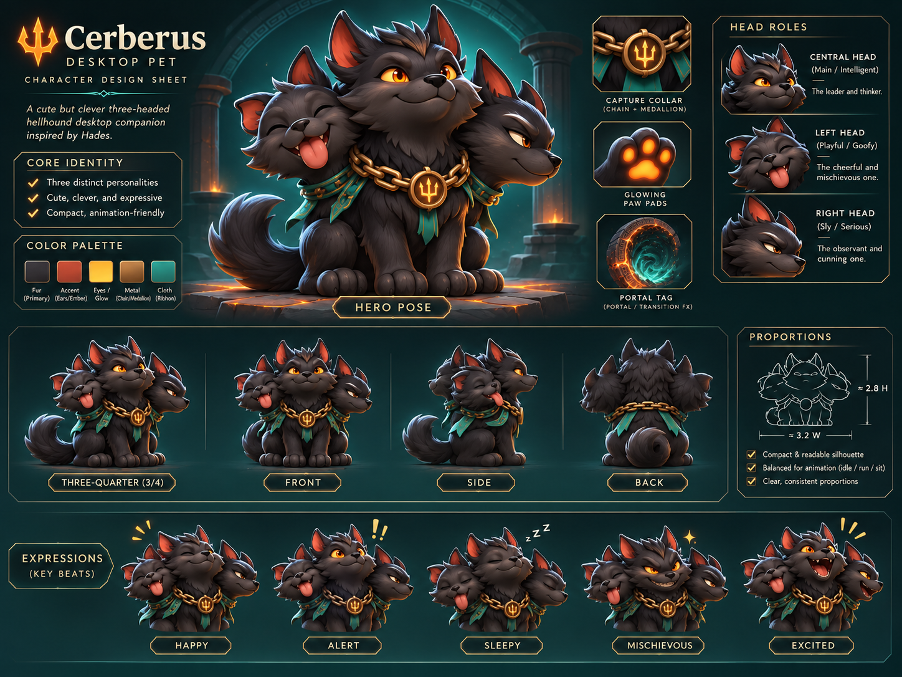
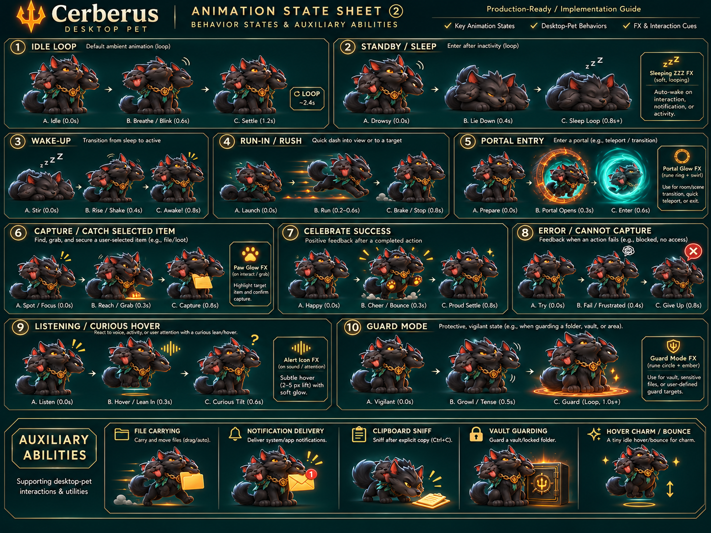
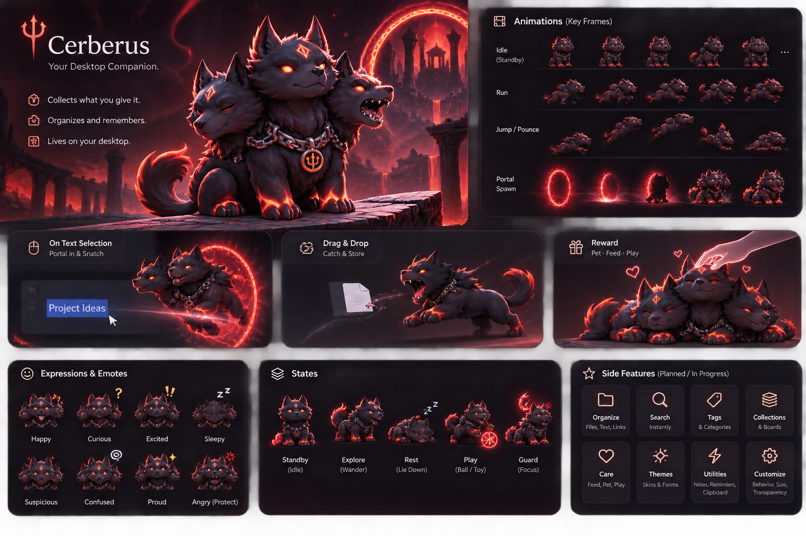
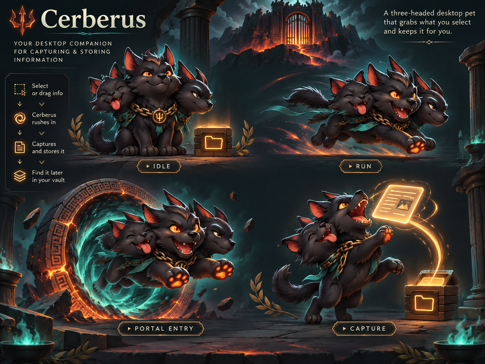

# Cerberus — Concept Gallery

Original AI-generated character/product concept artwork from the design phase, provided for reference and brand consistency. They are NOT transparent runtime animation sprites. The runtime production sprites reside under `cerberus/assets/` and the newly added experimental frame sequences under `assets/animations/`.

Use these as visual direction; do not claim that every pictured feature is implemented. Respect the actual repository [LICENSE](../../LICENSE) and [NOTICE](../../NOTICE).
